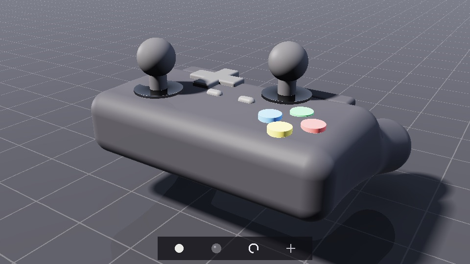
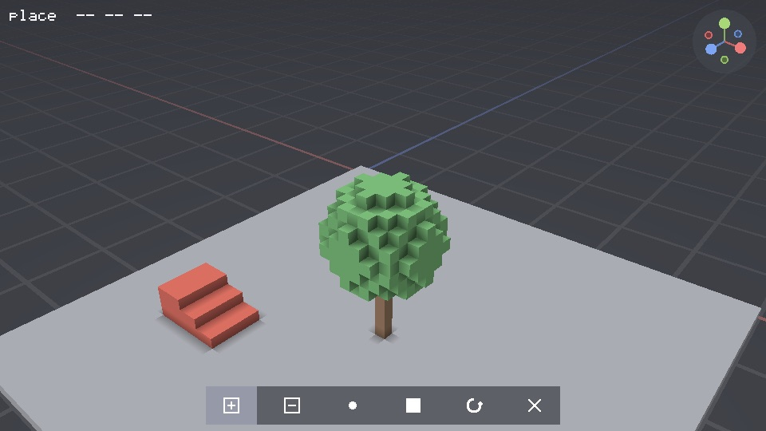

# Orla

**A runtime for software that evolves while it runs, built for AI agents to create with.**



<sub>Every pixel above is computed by Kernels written in `.orla` and composed by a `.osn` scene
([`examples/showcase`](examples/showcase/README.md)). The Host knows no gamepads, no shading, no toolbar.</sub>

> **Host is the world.**
> **Kernel is the law.**
> **Graph is the structure.**
> **AI is the creator.**

## What Orla is

- **Kernels are the laws.** A Kernel is a small typed function, `Y = K(X, P, C)`: inputs, parameters,
  context in; outputs out. It reaches the machine only through the capabilities it declares and is
  granted.
- **Graphs are the structure.** A scene composes Kernels by stable id (`image.blur@1`) and wires their
  typed ports. Kernel owns computation; Graph owns relationships.
- **The Host is the world.** It owns memory, devices and time, and nothing else. Images, sound,
  geometry, rigs and game state are one resource: a typed Field.
- **Change is atomic.** A new Kernel is compiled, validated and prepared beside the running one, then
  swapped in whole. A rejected change leaves the running program as it was.
- **One IR, many machines.** Every Kernel lowers to one backend-neutral IR, run by a reference
  interpreter, a JIT (native code through Cranelift, or WebAssembly) and the GPU (WGSL through wgpu).
  The interpreter is the reference; the JIT matches it bit for bit.

## A Kernel and a scene

```text
// kernels/grayscale.orla
kernel image.grayscale@1 {
    requires { field.read; field.write; }
    input source: Image;
    param amount: Float = 1.0;
    output result: Image;
    fn luma(c: Vec4) -> Float {
        return c.r * 0.2126 + c.g * 0.7152 + c.b * 0.0722;
    }
    compute {
        let c = sample(source);
        let g = luma(c);
        return mix(c, vec4(g, g, g, c.a), amount);
    }
}
```

```text
// scene.osn
use "kernels/";

node source: image.gradient@1 { domain = vec2(128, 128); }
node gray:   image.grayscale@1 { source <- source.result; amount = 1.0; }
node blocks: image.pixelate@1  { source <- gray.result; size = 8; }

output result <- blocks.result;
```

Edit either file while it runs: the new version replaces the old at the next frame, or is refused with
a diagnostic at `file:line:column` while the old one keeps running.

## Start

Download a release from [Releases](https://github.com/Fynn-3D/orla/releases),
unpack it, and run `bin/orla` from its directory:

```sh
bin/orla new hello                                  # a scene that runs: Kernel, scene, test
bin/orla player hello/scene.osn                     # open it in a window; edit the Kernel live
bin/orla run examples/grayscale/scene.osn --out gray.png
bin/orla help                                       # everything a Kernel may call
```

From the source (Rust 1.93 or later), `cargo build --release` puts the
same programs in `target/release/`.

## For AI agents

An agent creates through one open protocol: JSON lines over stdin and stdout, a socket, a WebSocket,
or a C function. Any model, any language, any CLI; the same authority rules for all.

```sh
bin/orla serve examples/life/scene.osn
```

```text
→ {"id":1,"op":"status"}
← {"id":1,"ok":{"backend":"jit","kernels":5,"nodes":3,"revision":4,"scene":"examples/life/scene.osn",...}}
→ {"id":2,"op":"prepare","source":"kernel demo.tint@1 { ... vec4(1.0, 0.5, nope, 1.0) ... }"}
← {"id":2,"error":{"line":1,"column":152,"message":"`nope` is not defined"}}
```

| Step | Operations |
| --- | --- |
| Inspect | `status`, `kernels`, `kernel`, `graph`, `document`, `help` |
| Propose | `prepare`: diagnostics, nothing published |
| Publish | `publish` against an expected generation |
| Compose | `compose` the scene by text or by named edits, `param` |
| Observe | `evaluate`, `read`, `trace`, `bench` |
| Keep and return | `snapshot`, `restore`, `history` |

What an agent can rely on:

- **Authority is granted.** A Kernel runs with the capabilities the person running the session grants;
  files are read and written only in directories they allow.
- **Every change is validated first.** A Kernel or a scene is compiled and checked before it replaces
  anything; publication is atomic and checked against the generation the agent last saw.
- **State commits only when truth is valid.** A frame's state and file writes commit only when the
  whole evaluation succeeds.
- **The world is observable.** Any port can be read, any element traced through its Kernel, any node
  timed; a run is a replay, and a replay is a test.

An MCP client uses the same session as tools: `bin/orla serve <scene.osn> --mcp` is its server
command, each operation a tool with its request's schema. The operations, fields and answers are in
[the protocol](docs/PROTOCOL.md). Bridges speak the same
protocol from [Blender](bridges/blender/README.md), [Godot](bridges/godot/README.md),
[a web page](bridges/web/README.md) and [C](bridges/c/README.md).

## What runs on it



54 examples, each a scene, its Kernels and its replay tests, none with a line of Rust:

| | |
| --- | --- |
| **Rendering** | path tracing, ray marching, deferred shading, a rasterizer written as Kernels, ten million culled triangles, volumes, text |
| **Simulation** | a million bodies, smoke by Navier-Stokes, neighbour search, wave function collapse |
| **Learning** | networks trained by gradient descent, one learning how far a cube puzzle is scrambled |
| **Sound** | a synthesizer, plucked strings, a sampler, a spectrum, MIDI in and out |
| **Rigs** | glTF and Blender rigs posed, blended, aimed and walked by the `skin` package |
| **Games and machines** | Snake, falling blocks, a tactics game, a voxel editor, a CHIP-8 interpreter, an ARM Thumb core |

Browse them in [`examples/`](examples/README.md).

## How it is built

```text
Host Core        memory, devices, time, budgets
Capability ABI   declared capabilities, opaque handles
Orla IR          typed computation, backend-neutral
Kernel Runtime   prepare, validate, atomic swap
Graph Runtime    composition by KernelID, typed ports
Interfaces       CLI, Player, protocol, C ABI, bridges
```

Rust, in layers held by tests: the core depends on the core alone, a backend on the core alone, and
only the interface layer on everything. The core and front end take no external dependency; `unsafe`
lives in two crates, the JIT and the C ABI. Verified on macOS (Apple silicon, Metal), under WASI, and
in the browser on WebAssembly and WebGPU.

## Read further

| Question | Document |
| --- | --- |
| The architecture and its boundaries | [CORE-ARCHITECTURE](CORE-ARCHITECTURE.md), [ARCHITECTURE-PLAN](ARCHITECTURE-PLAN.md) |
| Why one resource | [Typed Fields](docs/TYPED-FIELD-ARCHITECTURE.md) |
| How a Kernel or a scene is written | [Documents](docs/DOCUMENTS.md) |
| What an agent sends | [Protocol](docs/PROTOCOL.md) |
| Which command does what | [Usage](docs/USAGE.md) |
| Why it is this way | [Decisions](docs/DECISIONS.md) |
| Where the code and its evidence are | [Implementation](IMPLEMENTATION.md) |
| The rules for working on Orla | [AGENTS](AGENTS.md), [PROCESS](PROCESS.md) |

## License

MIT, see [LICENSE](LICENSE).

> **Keep the world stable.**
> **Keep the laws replaceable.**
> **Keep composition open.**
> **Let capability grow.**
