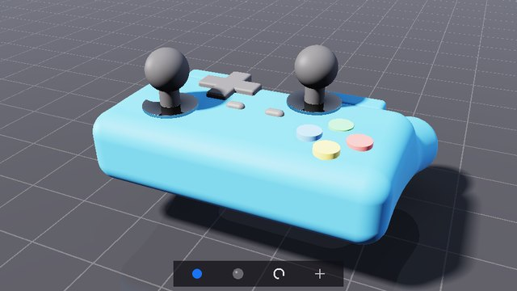
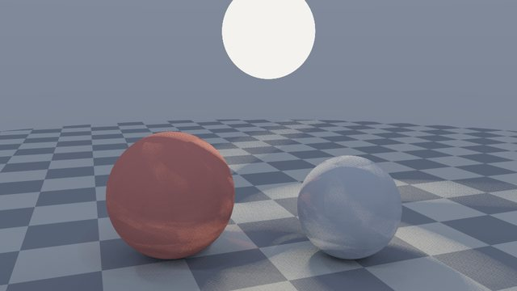
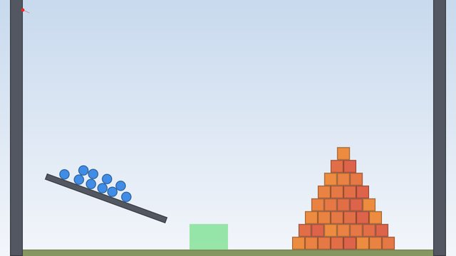
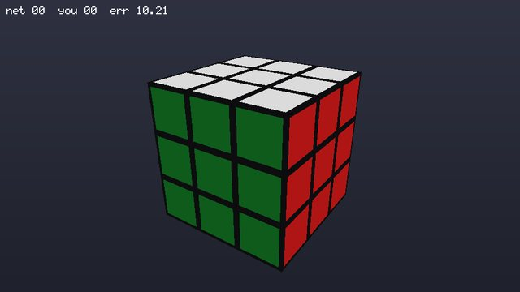

<p align="center">
  <picture>
    <source media="(prefers-color-scheme: dark)" srcset="docs/media/entelechy-logo-dark.png">
    
  </picture>
</p>

<h3 align="center">Software that becomes, while it runs.</h3>

<p align="center">
A runtime where programs are grown, not shipped: AI writes the laws, composes the structure,
and changes both while the world keeps running.
</p>

> **Host is the world.**
> **Kernel is the law.**
> **Graph is the structure.**
> **AI is the creator.**

## Everything here was computed

<table>
  <tr>
    <td width="33%"><a href="examples/showcase/README.md"></a><br><sub><b>A product shot,</b> modeled by signed distances and lit by physically based shading.</sub></td>
    <td width="33%"><a href="examples/path/README.md"></a><br><sub><b>Light, traced.</b> A progressive path tracer: samples and bounces are graph parameters.</sub></td>
    <td width="33%"><a href="examples/nebula/README.md"></a><br><sub><b>A nebula from noise,</b> finished as film: glow, depth of field, grain.</sub></td>
  </tr>
  <tr>
    <td width="33%"><a href="examples/physics/README.md"></a><br><sub><b>Boxes and balls</b> that fall, stack, slide and bounce, stepped by the physics package.</sub></td>
    <td width="33%"><a href="examples/cube-puzzle/README.md"></a><br><sub><b>A network learns</b> how far a cube puzzle is scrambled, trained by gradient descent.</sub></td>
  </tr>
</table>

Every pixel above is computed by Kernels written in `.ent` and composed by `.esn` scenes, and every one
of these programs is tested by replays, none with a line of Rust. The Host knows no gamepad, no light, no
cube. It knows memory, devices and time.

## How a program becomes

**A law.** A Kernel is a small typed function, `Y = K(X, P, C)`. It reaches the machine only through the
capabilities it declares and is granted.

```text
// kernels/grayscale.ent
kernel image.grayscale@1 {
    requires { field.read; field.write; }
    input source: Image;
    param amount: Float = 1.0;
    output result: Image;
    fn luma(c: Vec4) -> Float {
        return dot(c.rgb, vec3(0.2126, 0.7152, 0.0722));
    }
    compute {
        let c = sample(source);
        let g = luma(c);
        return mix(c, vec4(g, g, g, c.a), amount);
    }
}
```

**A structure.** A scene composes Kernels by stable id and wires their typed ports. Kernel owns
computation; Graph owns relationships.

```text
// scene.esn
use "kernels/";

node source: image.gradient@1 { domain = vec2(128, 128); }
node gray:   image.grayscale@1 { source <- source.result; amount = 1.0; }
node blocks: image.pixelate@1  { source <- gray.result; size = 8; }

output result <- blocks.result;
```

**A change, while it runs.** Edit either file and the new version is compiled, validated and prepared
beside the running one, then swapped in whole at the next frame. A change that is wrong is refused at
`file:line:column`, and the world keeps running as it was.

Images, sound, geometry, rigs and game state are one resource, a typed Field. Every Kernel lowers to one
backend-neutral IR, run by a reference interpreter, a JIT (native code through Cranelift, or
WebAssembly) and the GPU (WGSL through wgpu). The interpreter is the reference; the JIT matches it bit
for bit.

## AI is the creator

An agent creates through one open protocol: JSON lines over stdin and stdout, a socket, a WebSocket, or
a C function. Any model, any language, any CLI; the same authority rules for all.

```sh
entelechy serve examples/life/scene.esn
```

```text
→ {"id":1,"op":"status"}
← {"id":1,"ok":{"backend":"jit","kernels":5,"nodes":3,"revision":4,"scene":"examples/life/scene.esn",...}}
→ {"id":2,"op":"prepare","source":"kernel demo.tint@1 { ... vec4(1.0, 0.5, nope, 1.0) ... }"}
← {"id":2,"error":{"line":1,"column":152,"message":"`nope` is not defined"}}
```

The safe path is the powerful path:

- **Authority is granted.** A Kernel runs with the capabilities the person running the session grants;
  files are read and written only in directories they allow.
- **Every change is validated first.** A Kernel or a scene is compiled and checked before it replaces
  anything; publication is atomic and checked against the generation the agent last saw.
- **State commits only when truth is valid.** A frame's state and file writes commit only when the whole
  evaluation succeeds.
- **The world is observable.** Any port can be read, any element traced through its Kernel, any node
  timed; a run is a replay, and a replay is a test.

`entelechy help` prints the syntax and API of every layer ([the same text](docs/REFERENCE.md)); the
operations, fields and answers are in [the protocol](docs/PROTOCOL.md). Bridges speak the same protocol
from [Blender](bridges/blender/README.md), [Godot](bridges/godot/README.md),
[a web page](bridges/web/README.md) and [C](bridges/c/README.md).

## Start

From the source (Rust 1.93 or later), `cargo build --release` puts the programs in `target/release/`.

```sh
entelechy new hello                                  # a scene that runs: Kernel, scene, test
entelechy player hello/scene.esn                     # open it in a window; edit the Kernel live
entelechy run examples/grayscale/scene.esn --out gray.png
entelechy help                                       # the syntax and API of every layer
```

## What runs on it

| | |
| --- | --- |
| **Rendering** | path tracing, ray marching, deferred shading, a rasterizer written as Kernels, ten million culled triangles, volumes, vectors, text |
| **Simulation** | a million bodies, smoke by Navier-Stokes, neighbor search, rigid bodies, wave function collapse |
| **Learning** | networks trained by gradient descent, one learning how far a cube puzzle is scrambled |
| **Sound** | a synthesizer, plucked strings, a sampler, a spectrum, MIDI in and out |
| **Rigs** | glTF and Blender rigs posed, blended, aimed and walked by the `animation` package |
| **Games and machines** | Snake, falling blocks, a tactics game, a voxel editor, a CHIP-8 interpreter, an ARM Thumb core |

Each is a scene, its Kernels and its replay tests: browse them in [`examples/`](examples/README.md).

## How it is built

```text
Host Core        memory, devices, time, budgets
Capability ABI   declared capabilities, opaque handles
Entelechy IR     typed computation, backend-neutral
Kernel Runtime   prepare, validate, atomic swap
Graph Runtime    composition by KernelID, typed ports
Interfaces       CLI, Player, protocol, C ABI, bridges
```

Rust, in layers held by tests: the core depends on the core alone, a backend on the core alone, and only
the interface layer on everything. The core and front end take no external dependency; `unsafe` lives in
two crates, the JIT and the C ABI. Verified on macOS (Apple silicon, Metal), under WASI, and in the
browser on WebAssembly and WebGPU.

## Read further

| Question | Document |
| --- | --- |
| The architecture and its boundaries | [CORE-ARCHITECTURE](CORE-ARCHITECTURE.md), [ARCHITECTURE-PLAN](ARCHITECTURE-PLAN.md) |
| Why one resource | [Typed Fields](docs/TYPED-FIELD-ARCHITECTURE.md) |
| Everything a Kernel, a scene and an agent may write, at once | [Reference](docs/REFERENCE.md) |
| How a Kernel or a scene is written | [Documents](docs/DOCUMENTS.md) |
| What an agent sends | [Protocol](docs/PROTOCOL.md) |
| Which command does what | [Usage](docs/USAGE.md) |
| Why it is this way | [Decisions](docs/DECISIONS.md) |
| Where the code and its evidence are | [Implementation](IMPLEMENTATION.md) |
| The rules for working on Entelechy | [AGENTS](AGENTS.md), [PROCESS](PROCESS.md) |

## License

MIT, see [LICENSE](LICENSE).

> **Keep the world stable.**
> **Keep the laws replaceable.**
> **Keep composition open.**
> **Let capability grow.**
