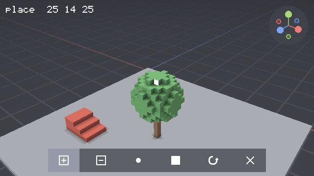

<p align="center">
  <picture>
    <source media="(prefers-color-scheme: dark)" srcset="docs/media/entelechy-logo-dark.png">
    
  </picture>
</p>

<h3 align="center">Software that becomes, while it runs.</h3>

<p align="center">
A runtime where worlds, tools and machines are written as pure typed laws, composed as live graphs,<br>
verified as replays, evolved while running, and carried anywhere.
</p>

<p align="center">
  <a href="#how-a-program-becomes">How it works</a> ·
  <a href="#ai-is-the-creator">Creation protocol</a> ·
  <a href="#start">Start</a> ·
  <a href="packages/README.md">Packages</a> ·
  <a href="examples/README.md">Examples</a> ·
  <a href="docs/REFERENCE.md">Reference</a> ·
  <a href="CORE-ARCHITECTURE.md">Architecture</a>
</p>

> **Host is the world.**
> **Kernel is the law.**
> **Graph is the structure.**
> **AI is the creator.**

## Everything here was computed

<table>
  <tr>
    <td width="33%"><a href="examples/showcase/README.md"></a><br><sub><b>A product shot,</b> modeled by signed distances and lit by physically based shading.</sub></td>
    <td width="33%"><a href="examples/path/README.md"></a><br><sub><b>Light, traced.</b> A progressive path tracer: samples and bounces are graph parameters.</sub></td>
    <td width="33%"><a href="examples/nebula/README.md"></a><br><sub><b>A nebula from noise,</b> finished as film: glow, depth of field, grain.</sub></td>
  </tr>
  <tr>
    <td width="33%"><a href="examples/physics/README.md"></a><br><sub><b>Boxes and balls</b> that fall, stack, slide and bounce, stepped by the <code>physics</code> package.</sub></td>
    <td width="33%"><a href="examples/cube-puzzle/README.md"></a><br><sub><b>A network learns</b> how far a cube puzzle is scrambled, trained by gradient descent.</sub></td>
    <td width="33%"><a href="examples/voxel/README.md"></a><br><sub><b>A voxel editor</b> over a <code>Volume&lt;Int&gt;</code>, ray-walked with undo, an axis compass and a toolbar.</sub></td>
  </tr>
</table>

Every pixel, waveform, collision, gradient step and widget above — [the logo at the top of this page included](examples/logo/README.md) — is computed by `.ent` Kernels, composed by `.esn` scenes, and verified by `.replay` scripts, none with a line of application Rust. The Host knows no gamepad, no light, no cube, no editor. It knows memory, devices, files and time.

## How a program becomes

**A law (`.ent`).** A Kernel is a small typed function, `Y = K(X, P, C)`. It reaches the machine only through the capabilities it declares and is granted.

```text
// kernels/grayscale.ent
kernel image.grayscale@1 {
    requires { field.read; field.write; }
    input source: Image;
    param amount: Float = 1.0;
    output result: Image;
    fn luma(c: Vec4) -> Float {
        return dot(c.rgb, vec3(0.2126, 0.7152, 0.0722));
    }
    compute {
        let c = sample(source);
        let g = luma(c);
        return mix(c, vec4(g, g, g, c.a), amount);
    }
}
```

**A structure (`.esn`).** A scene composes Kernels by versioned `KernelID`, wires their typed ports, carries state across frames explicitly through `<~`, and places subgraphs as nodes. Kernel owns computation; Graph owns relationships.

```text
// scene.esn
use "kernels/";

node source: image.gradient@1 { domain = vec2(128, 128); }
node gray:   image.grayscale@1 { source <- source.result; amount = 1.0; }
node blocks: image.pixelate@1  { source <- gray.result; size = 8; }

output result <- blocks.result;
```

**A proof (`.replay`).** A replay feeds inputs, steps frames, and checks pixels or typed Field elements across backends, with no native rebuild.

```text
# tests/grayscale.replay
scene ../scene.esn
frame 0.0
expect 0 0 = 0.036 0.036 0.036 0.002
expect 64 64 = 0.504 0.504 0.504 0.002
expect 127 127 = 0.913 0.913 0.913 0.002
```

**A change, while it runs.** Edit either source and the replacement is compiled, validated and prepared beside the living graph, then swapped in whole at the frame boundary. A change that fails validation is refused at `file:line:column`, and the running world stays alive. In [`genesis`](examples/genesis/README.md), a running scene writes a new `.ent` law through an explicit `to files` output, reads compiler diagnostics back through `= checks`, and hot-swaps its own law of growth on the next frame.

## One resource, three backends

Images, sound blocks, meshes, skeletons, neural weights, UI layouts and virtual-machine memory share one representation: a **typed Field** (`Rows<T>`, `Grid<T>`, `Volume<T>`, `Image`), computed through element maps, named multi-outputs, `merge` reductions, `scan` over memory, atomic `scatter` and off-frame `async` work ([`modes`](examples/modes/README.md), [Typed Fields](docs/TYPED-FIELD-ARCHITECTURE.md)).

Every Kernel lowers to one backend-neutral IR and runs across three backends:

- **`cpu`** — the dependency-free reference interpreter.
- **`jit`** — native machine code through Cranelift, or WebAssembly in a browser and under WASI, matching `cpu` bit for bit.
- **`gpu`** — compute shaders in WGSL through `wgpu`, keeping Fields resident on the device across nodes and frames.

## AI is the creator

An agent creates through one open protocol: JSON lines over stdin and stdout, a socket, a WebSocket, or a C function. Any model, any language, any CLI; the same authority and validation rules for all.

```sh
entelechy serve examples/life/scene.esn
```

```text
→ {"id":1,"op":"status"}
← {"id":1,"ok":{"backend":"jit","kernels":5,"nodes":3,"revision":4,"scene":"examples/life/scene.esn",...}}
→ {"id":2,"op":"prepare","source":"kernel demo.tint@1 { ... vec4(1.0, 0.5, nope, 1.0) ... }"}
← {"id":2,"error":{"line":1,"column":152,"message":"`nope` is not defined"}}
```

The safe path is the powerful path:

- **Authority is granted.** A Kernel runs only with the capabilities the person running the session grants; files are read and written only in directories they allow.
- **Every change is validated first.** A Kernel or a scene is compiled and checked before it replaces anything; publication is atomic and checked against the generation the agent last saw.
- **State commits only when truth is valid.** A frame's state and file writes commit only when the whole evaluation succeeds.
- **The world is observable.** Any port can be read, any element traced through its Kernel, any node timed; a run is a replay, and a replay is a test.

`entelechy help` prints the syntax and API of every layer directly from the tables the runtime executes ([the same text](docs/REFERENCE.md)); the wire operations and answers are in [the protocol](docs/PROTOCOL.md). Bridges speak the same contract from [Blender](bridges/blender/README.md), [Godot](bridges/godot/README.md), [a web page](bridges/web/README.md) and [C](bridges/c/README.md).

## Start

From the source (Rust 1.93 or later), `cargo build --release` puts the programs in `target/release/`.

```sh
entelechy new hello                                          # scaffold Kernel, scene and replay test
entelechy player hello/scene.esn                             # open live; edit hello.ent while it runs
entelechy replay hello/tests/hello.replay                    # verify frame by frame across backends
entelechy run examples/grayscale/scene.esn --out gray.png    # evaluate once and write an output
entelechy export examples/voxel/scene.esn --out voxel.html   # pack runtime + scene into one HTML page
entelechy help                                               # inspect the syntax and API of every layer
```

`entelechy export <scene.esn> --out <page>.html` compiles a scene's validated IR, lowered Graph, baked Fields and subsetted font contours together with Entelechy's WebAssembly/WebGPU page runtime into a single self-contained HTML file that opens straight from disk and fetches nothing. `entelechy import` and `entelechy export` also round-trip glTF/GLB meshes and skinned rigs, audio, MIDI, SVG vectors and OpenType/WOFF fonts into and out of typed Fields ([Usage](docs/USAGE.md)).

## Capabilities grow as packages

The Host stays small and the language stays quiet; reusable domains live in [`packages/`](packages/README.md). Each `.entpkg` carries functions, versioned Kernels, subgraph presets and cross-backend replay proofs:

| Layer | Packages |
| --- | --- |
| **Foundation** | [`random`](packages/random.entpkg/README.md) · [`geometry`](packages/geometry.entpkg/README.md) · [`parallel`](packages/parallel.entpkg/README.md) · [`signal`](packages/signal.entpkg/README.md) · [`navigation`](packages/navigation.entpkg/README.md) |
| **Graphics** | [`image`](packages/image.entpkg/README.md) · [`raster`](packages/raster.entpkg/README.md) · [`voxel`](packages/voxel.entpkg/README.md) · [`vector`](packages/vector.entpkg/README.md) · [`mesh`](packages/mesh.entpkg/README.md) · [`terrain`](packages/terrain.entpkg/README.md) · [`texture`](packages/texture.entpkg/README.md) |
| **Media** | [`audio`](packages/audio.entpkg/README.md) · [`music`](packages/music.entpkg/README.md) |
| **Simulation** | [`physics`](packages/physics.entpkg/README.md) · [`animation`](packages/animation.entpkg/README.md) |
| **Interaction** | [`text`](packages/text.entpkg/README.md) · [`ui`](packages/ui.entpkg/README.md) · [`controls`](packages/controls.entpkg/README.md) |

## What runs on it

| Domain | Programs in [`examples/`](examples/README.md) |
| --- | --- |
| **Rendering** | [path tracing](examples/path/README.md), [signed-distance PBR](examples/showcase/README.md), [software & native rasterization](examples/mesh/README.md), [ten million culled triangles](examples/culled/README.md), [marching surfaces](examples/surface/README.md), [nebula & film look](examples/nebula/README.md), [vector art](examples/vector/README.md), [constructed logo & blueprint](examples/logo/README.md) |
| **Simulation** | [a million bodies & spatial hashing](examples/swarm/README.md), [Navier-Stokes smoke](examples/fluid/README.md), [rigid bodies](examples/physics/README.md), [wave function collapse](examples/collapse/README.md) |
| **Self-evolving & learning** | [a world that rewrites its own `.ent` law](examples/genesis/README.md), [networks trained by gradient descent](examples/learn/README.md), [a cube puzzle & its learned heuristic](examples/cube-puzzle/README.md) |
| **Sound** | [a synthesizer, FFT spectrum, plucked strings, drum sampler, MIDI & procedural score](examples/sound/README.md) |
| **Rigs** | [glTF and Blender skeletons posed, blended, aimed and walked](examples/animation/README.md) |
| **Games, editors & machines** | [voxel editor & lit crypt](examples/voxel/README.md), [turn-based tactics](examples/slg/README.md), [falling blocks & snake](examples/arcade/README.md), [settings & HUD](examples/ui/README.md), [CHIP-8 & ARM7TDMI Thumb cores](examples/machines/README.md) |

## How it is built

```text
Host Core        memory, devices, files, time, budgets
Capability ABI   declared capabilities, opaque handles
Entelechy IR     typed computation, backend-neutral
Kernel Runtime   prepare, validate, atomic swap
Graph Runtime    composition by KernelID, typed ports
Interfaces       CLI, Player, protocol, single-page export, C ABI, bridges
```

Rust, in layers held by tests: `core` depends on `core` alone, `frontend` on `core`, a backend on `core` alone, and only the interface layer on everything. `core`, `frontend` and the reference interpreter take zero external dependencies; `unsafe` lives in two crates, `entelechy-jit` (calling the native code it emits) and `entelechy-ffi` (reading C pointers at the boundary). Verified on macOS (Apple silicon, Metal), under WASI, and in the browser on WebAssembly and WebGPU.

## Read further

| Question | Document |
| --- | --- |
| The architecture and its boundaries | [CORE-ARCHITECTURE](CORE-ARCHITECTURE.md), [ARCHITECTURE-PLAN](ARCHITECTURE-PLAN.md) |
| Why one resource | [Typed Fields](docs/TYPED-FIELD-ARCHITECTURE.md) |
| Reusable capability domains | [Packages](packages/README.md) |
| Whole runnable programs | [Examples](examples/README.md) |
| Everything a Kernel, a scene and an agent may write | [Reference](docs/REFERENCE.md) |
| How a Kernel or a scene is written | [Documents](docs/DOCUMENTS.md) |
| What an agent sends over the wire | [Protocol](docs/PROTOCOL.md) |
| Which command does what | [Usage](docs/USAGE.md) |
| How skeletons, weights and clips are stored | [Rigs](docs/RIGS.md) |
| Why it is this way | [Decisions](docs/DECISIONS.md) |
| Where the code and its evidence are | [Implementation](IMPLEMENTATION.md) |
| The rules for working on Entelechy | [AGENTS](AGENTS.md), [PROCESS](PROCESS.md) |

## License

MIT, see [LICENSE](LICENSE).

> **Keep the world stable.**
> **Keep the laws replaceable.**
> **Keep composition open.**
> **Let capability grow.**
